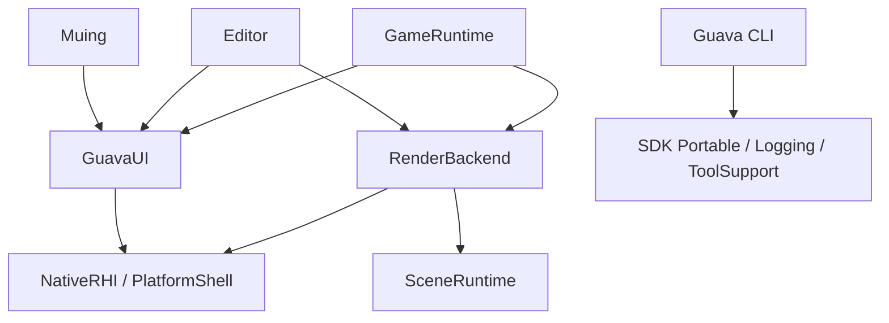

# 模块、入口与平台边界

GuavaUI 是独立 SDK，拥有 UI 与通用底层；GuavaStudio 拥有场景与三维渲染。应用宿主负责把二者组合起来，两侧都不认识对方的上层概念。

```swift
import GuavaUI

try Application.run { Text("Hello, GuavaUI!").padding(24) }
```

## 依赖方向



三条规则：

1. `GuavaUI` 不依赖 Studio 的任何包。它只依赖外部包（yoga、swift-nio、swift-log、swift-markdown）。
2. `Engine` 只消费 SDK 的通用底层产品（`NativeRHI`、`PlatformShell`、`ImageDecodeBridge`、`GuavaLogging`、`GuavaPlatformCore`、`GuavaUIAgentCore`、`CSDL3`、`CGuavaLog`），不引用 `GuavaUICompose`、`GuavaUIRuntime`、`GuavaUIWorkspace` 等 UI 层模块。
3. `Editor` 是唯一同时依赖 `Engine` 与 `GuavaUI` 的包，组合发生在这里。

`guava-dev boundaries` 强制前两条；第 3 条由工作区包只依赖 `Editor` 保证。

## 职责与所有权

| 边界 | 所有权 | 应用侧用法 |
| --- | --- | --- |
| `GuavaUI`（SDK 仓库） | Application、窗口生命周期、应用资源、诊断接线 | 默认入口 |
| `GuavaUICompose` | 原生组件、主题、布局 | 通过 `GuavaUI` 获得 |
| `GuavaUIComposeCore` | Compose 核心、View 协议、Primitive 视图 | 平台宿主实现使用 |
| `GuavaUIScene` | 可移植场景、输入、无障碍语义 | Compose 与 DevTools 使用 |
| `GuavaUIRuntime` | 原生字体 / 图像服务、SDL 宿主、NativeRHI UI renderer | 原生宿主、renderer 集成使用 |
| `GuavaUIText` | FreeType / HarfBuzz、字体图集与排版 | 文字后端集成使用 |
| `GuavaUIWorkspace` | 工作台模型、面板元数据、注册表、停靠交互 | 工具应用显式导入 |
| `GuavaUIWebView` | 宿主注入的网页布局、裁剪与生命周期 | 需要内嵌网页的应用显式导入 |
| `GuavaUIAgent` | 通用工具契约、模型工具循环、MCP、skills 与 UI 诊断查询 | AI 集成显式导入 |
| `GuavaUIDevTools` | 调试服务、镜像、性能采样 | 开发构建使用 |
| `GuavaUITerminal` | Ghostty 终端引擎与会话 | 终端面板使用 |
| `NativeRHI` | Metal / DX12 / Vulkan 后端与统一 RHI | UI 与引擎共用 |
| `PlatformShell` | SDL3 窗口、事件、剪贴板、显示刷新 | UI 与引擎共用 |
| `GuavaLogging` / `GuavaLogCore` | swift-log 后端、结构化记录、输出与订阅 | 由 `GuavaUI` 导出 |
| `GuavaPlatformCore` | 输入事件、光标、滚动、窗口标识等可移植值 | 底层共用 |
| `GuavaUIAndroid` | 与 Surface 生命周期独立的 Compose / 输入会话 | JNI Surface 宿主使用 |
| `RenderBackend`（Studio） | 渲染图、通道、材质、目标 | 三维宿主使用 |
| `SceneRuntime`（Studio） | 场景、物理、动画、实体调度 | 三维宿主使用 |
| `EngineCore`（Studio） | 引擎宿主、渲染线程、模拟线程 | 游戏运行时使用 |
| `EditorCore` / `EditorUI` | 编辑器领域、窗口、面板与启动编排 | EditorApp 的唯一实现来源 |
| `GuavaUI/Tools/Guava` | 统一 CLI、项目配置、脚手架、桌面 / Android / iOS 构建 | create / build / run / clean / test |
| `GuavaUI/Hosts/Android/Contract` | APK 生产者和消费者共用的启动文档 | 工具与运行时使用同一个 Codable 类型 |
| `Tools/Developer` | 仓库内开发工具（边界、可维护性、原生依赖引导） | 只依赖 `GuavaUI/Tools/Support` |

`CLI` 与 SDK 同仓，但编译 CLI 的依赖图不含窗口与 GPU 模块；它只依赖 `Portable`、`Logging`、`Hosts/Android/Contract`、`Tools/Support`。

## UI 与引擎的图形交互

两侧通过图形结果交互，不共享视图树或场景类型。

- 显示三维视口：引擎产出纹理（`ViewportSurfaceState` / `ViewportImage`），`EditorCore` 中的适配器把它交给 UI 的 `TextureImage`，绘制列表按图像所有权自动保持纹理驻留。
- 绘制游戏 HUD：UI 产出 `DrawListSnapshot`，宿主在引擎提供的绘制位置录制（`InGameUIProviding` / `NativeInGameUITarget`）。

`InGameUIProviding` 的输入是引擎当帧的 `RenderPacket` 与借用中的 `NativeInGameUITarget`，输出是可选的 `InGameUIRecording`（提交后调用 `didSubmit()`）。UI 层不认识场景、物理或 `RenderPacket`；引擎层不认识 Compose 的视图树。

## 单一数据来源

- `ApplicationConfiguration` 分成 window、typography、rendering、frames、diagnostics。默认值位于各组所属字段。
- `RenderSettings` 分成 shading、postProcessing、visibility、viewport、shadows、stylization。
- `WorkspacePanelDescriptor` 持有规范的 WorkspacePanel 值以及临时视图工厂；注册表只有一份。
- Android 构建工具与宿主共用 `SceneLaunch`。
- 根工作区的 GuavaStudio 与 Editor 的 EditorApp 使用同一个启动文件，Editor 的 target 定义只在 `Editor/Package.swift` 维护。
- 脚手架资源与示例 AppContent 使用相同入口；`boundaries` 校验模板与示例逐字节一致。
- `guava.json` 的 `toolchain.sdkVersion` 是 SDK 版本的唯一来源；`Package.swift` 与 CLI 读取同一份配置。

## 迁移

这是开发阶段的直接迁移，不提供旧模块或类型别名。

| 原入口 | 当前入口 |
| --- | --- |
| `Engine/Logging` | `GuavaUI/Logging`（`GuavaUI` 产品 `GuavaLogging`） |
| `Engine/PlatformCore` | `GuavaUI/PlatformCore`（产品 `GuavaPlatformCore`） |
| `Engine/Sources/NativeRHI` | `GuavaUI/Runtime/Sources/NativeRHI`（产品 `NativeRHI`） |
| `Engine/Sources/PlatformShell` | `GuavaUI/Runtime/Sources/PlatformShell` |
| `Engine/Sources/Bridge/CImageDecodeBridge` | `GuavaUI/Runtime/Sources/Bridge/CImageDecodeBridge`（产品 `ImageDecodeBridge`） |
| `Engine/Sources/Bridge/CDX12Bridge`、`CSDL3` | `GuavaUI/Runtime/Sources/Bridge/` |
| `GuavaUI/Portable`（独立包） | `GuavaUI/Portable`（SDK 内子包） |
| `Tools/Guava` | `GuavaUI/Tools/Guava` |
| `Platforms/Android/Contract` | `GuavaUI/Hosts/Android/Contract` |
| `guava.json` 的 `toolchain.enginePath` | `toolchain.sdkVersion` + `GUAVA_SDK_ROOT` |
| `GuavaUIApp` / `AppRuntime.run` / `AppConfig` | `GuavaUI` / `Application.run` / `ApplicationConfiguration` |
| `GuavaUIGallery` | 示例包 `GalleryContent` |
| `GuavaAndroidContent` / `ApplicationContent.makeRoot` | `AppContent` / `makeApplicationContent` |
| `PanelWorkspace` | `WorkspaceView(controller:registry:compact:)` |

## 约束检查

```sh
./guava studio boundaries
./guava studio maintainability
./guava test GuavaUI
./guava test Engine
./guava test Editor
```

`boundaries` 读取实际 SwiftPM manifest，覆盖：SDK 不依赖 Studio、SDK 不 vend 引擎产品、Engine 不引用 UI 层产品、工作区唯一来源、Android 应用 / 游戏 / showcase 三种图、嵌入模板与示例一致、CLI 只依赖 SDK 包。

原生 GPU、桌面窗口、Android 触摸 / IME / 旋转 / 暂停恢复仍需对应集成测试；目录或导入检查不能代替这些验证。
