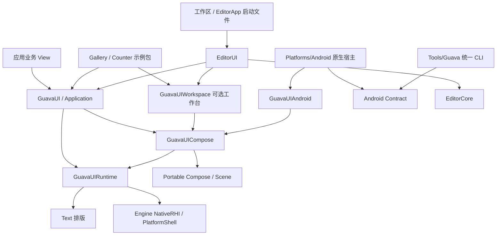

# 模块、入口与平台边界

默认应用入口属于 `GuavaUI`，内部模块服务于可移植性、宿主和集成边界。SwiftPM target 数量不是应用必须学习的 API 数量。普通应用只声明 `GuavaUI` 产品并 `import GuavaUI`；自定义渲染器、嵌入引擎、工作台和诊断工具才显式依赖相应集成模块。

```swift
import GuavaUI

try Application.run { Text("Hello, GuavaUI!").padding(24) }
```

SwiftUI 也把默认使用入口收敛到 `import SwiftUI`、App / Scene / View，窗口与渲染由框架管理。GuavaUI 用普通启动函数达到这一目的，无需应用再声明无业务意义的 App 协议适配类型。对照 [Apple 的 SwiftUI 应用结构](https://developer.apple.com/documentation/technologyoverviews/swiftui?language=objc)与 [SwiftPM 的 package / product / target 说明](https://docs.swift.org/latest/documentation/packagemanagerdocs/introducingpackages/)。

## 职责与所有权

| 边界 | 所有权 | 应用侧用法 |
| --- | --- | --- |
| `Engine` | NativeRHI、场景、资源、脚本、音频、引擎调度 | 按引擎集成需要显式依赖领域产品 |
| `Engine/Logging` | swift-log 后端、结构化记录、上下文、输出和有界订阅 | 普通应用由 GuavaUI 导出并初始化；协议只依赖 GuavaLogCore |
| `GuavaUI/Portable` | 可移植值、Compose 核心、场景 / 输入、DevTools 契约 | 浏览器或新平台宿主使用底层产品 |
| `GuavaUI/Text` | FreeType / HarfBuzz、字体图集与排版 | 文字后端集成使用 |
| `GuavaUIRuntime` | 原生字体 / 图像服务、SDL 宿主、NativeRHI UI renderer | 原生宿主、renderer 集成使用 |
| `GuavaUICompose` | 原生组件、主题与引擎视口适配 | 通过 `GuavaUI` 获得普通组件 |
| `GuavaUI` | Application、窗口生命周期、应用资源、诊断接线 | 默认入口 |
| `GuavaUIWorkspace` | 工作台模型、面板元数据、注册表、停靠交互 | 工具应用显式导入 |
| `GuavaUIAndroid` | 与 Surface 生命周期独立的 Compose / 输入会话 | JNI Surface 宿主使用 |
| `GuavaUI/Examples` | GalleryContent、Gallery / Pet 可执行程序 | 示例包，生产框架不依赖它 |
| `examples/Counter` | 浏览器与原生共用的 Counter 示例及其验收 | 示例包，Portable 不依赖它 |
| `Platforms/Android` | JNI、Java Surface / IME、应用 / 游戏宿主 | 平台基础设施同时服务 UI 与游戏 |
| `Tools/Guava` | 统一 CLI、项目配置、脚手架、桌面 / Android 构建后端 | create / build / run / clean / test |
| `Platforms/Android/Contract` | APK 生产者和消费者共用的启动文档 | 工具与运行时使用同一个 Codable 类型 |
| `EditorCore` | 编辑器项目与应用领域服务 | 编辑器和现有游戏项目加载服务使用 |
| `EditorUI` | 编辑器窗口、面板和启动编排 | EditorApp 的唯一实现来源 |
| 根 `Package.swift` | 工作区启动便利入口 | 只引用 EditorUI 产品，不复制其目标图 |



Android 的平台基础设施放在 GuavaUI 内会把游戏播放器、APK 工具和 JNI 生命周期错误地归给 UI。实际 UI 会话已放入 GuavaUI 的平台目录；共用宿主在 `Platforms/Android`，创建与构建工具在 `Tools/Guava`。桌面复用 SDL3 / NativeRHI 宿主，没有为每个平台创建空目录。完整 iOS / Web 应用宿主尚未实现。普通 UI APK、游戏 APK 与 showcase APK 选择不同的依赖图，普通 UI 构建不依赖 Editor、Gallery 或 Counter。

## 单一数据来源

- `ApplicationConfiguration` 分成 window、typography、rendering、frames、diagnostics。默认值位于各组所属字段；帧率验证由 frames 组拥有。默认 frames.policy 为 eventDriven。
- `RenderSettings` 分成 shading、postProcessing、visibility、viewport、shadows、stylization。阴影只由 shadows.enabled 控制，没有并行开关和兼容别名。
- `WorkspacePanelDescriptor` 持有规范的 WorkspacePanel 值以及临时视图工厂。注册表只有 WorkspacePanelRegistry 一份，不再在 App 层复制面板元数据与注册表。
- Android 构建工具与宿主共用 SceneLaunch。benchmark / timings / vsync、IME 预编辑、Surface 状态和输入捕获属于运行时，不进入 launch.json。
- 根工作区的 GuavaStudio 与 Editor 的 EditorApp 使用同一个启动文件，Editor 的 target 定义只在 Editor/Package.swift 维护。
- 脚手架资源与示例 AppContent 使用相同入口。创建器从嵌入模板产生应用；检查脚本验证模板和示例使用的产品、导入与入口一致。
- 删除了无资源、无行为的 GuavaUIBundledFonts 兼容 target。系统字体由现有 FontProvider / SystemFontDefaults 负责。

## 迁移

这是开发阶段的直接迁移，不提供旧模块或类型别名。

| 原入口 | 当前入口 |
| --- | --- |
| GuavaUIApp / AppRuntime.run / AppConfig | GuavaUI / Application.run / ApplicationConfiguration |
| GuavaUISharedDemo / SharedCounterView | 示例包 CounterExample / CounterView |
| GuavaUIGallery | 示例包 GalleryContent |
| GuavaAndroidContent / ApplicationContent.makeRoot | AppContent / makeApplicationContent 普通函数 |
| App 的 PanelID / PanelDescriptor / PanelRegistry | WorkspacePanelID / WorkspacePanelDescriptor / WorkspacePanelRegistry |
| PanelWorkspace | WorkspaceView(controller:registry:compact:) |
| Android 专用工具入口 | Tools/Guava 的统一 guava CLI |
| 根目录 swift run EditorApp | swift run GuavaStudio（Editor 包仍提供 EditorApp） |
| swift run --package-path GuavaUI GuavaUIDemo | swift run --package-path GuavaUI/Examples GuavaUIDemo |

最小应用在 examples/HelloUI。跨桌面 / Android 项目在 examples/GuavaUIStarter：CLI 生成的桌面入口调用 Application.run，Android 宿主安装同一个 AppContent 根视图。

## 约束检查

```sh
python3 scripts/check-module-boundaries.py
python3 scripts/check-swift-maintainability.py
swift test --package-path GuavaUI
swift test --package-path GuavaUI/Examples
swift test --package-path GuavaUI/Portable
swift test --package-path examples/Counter
swift test --package-path Platforms/Android/Contract
swift test --package-path Tools/Guava
```

边界检查读取实际 SwiftPM manifest，覆盖正式 UI 产品、工作区唯一来源、Android 应用 / 游戏 / showcase 三种图，以及嵌入的应用模板。原生 GPU、桌面窗口、Android 触摸 / IME / 旋转 / 暂停恢复还需要对应集成测试；目录或导入检查不能代替这些验证。

## 应用与工具依赖方向

代码依赖为 `Editor → GuavaUI → Engine`。Engine 提供基础设施，GuavaUI 封装 UI 能力，Editor 是使用它们的桌面应用，不反向进入 UI 的默认依赖。Editor/guava.json 声明其桌面产品；统一 CLI 读取配置后构建，不把 Editor 特判写入命令层。

一个应用由 guava create app 创建；guava build / run 选择目标，test 在主机运行单元测试，clean 只删除项目 .guava/build。application 身份、SDK 位置与目标配置集中在 guava.json，临时设备 / 签名参数不写回配置。桌面 Package.swift 与 CLI 读取同一个 SDK 路径；模板与仓库 Starter 由边界检查保持一致。详细命令、安装及支持边界见 [Guava CLI](../../Tools/Guava/README.md)。


## Application platform ownership and development tools

Application projects own their native `Platforms` directories: Android Gradle/Manifest/resources, macOS Info/entitlements/resources, Windows manifest and Linux desktop metadata. The SDK owns reusable platform runtime code. Ordinary UI projects export AppContent; the CLI generates the desktop launcher. Editor/Gallery explicitly select their own executable product with targets.desktopExecutable.

The installed SDK selection is user state; each application's toolchain.enginePath remains authored configuration. Version metadata is owned once by guava.json and applied during native packaging. CLI build caches and authenticated DevTools session descriptors stay under .guava/build.

DevTools has one Client tree consumed by native WebSocket hosts and the browser MessageChannel host. Protocol models, transport, session lifecycle and request domains have separate owners. Browser is a Swift/Wasm host prototype, not an implemented Web application target. Engine's plugin runtime uses pinned static Wasmtime artifacts on macOS, Windows, Linux and Android, with Pulley on iOS. `Platforms/Web/Plugins` owns the build-time Component conversion and browser Worker runtime. These plugin targets are independent of the portable UI host; see [plugin execution](plugin-execution.md) for isolation and delivery boundaries.
